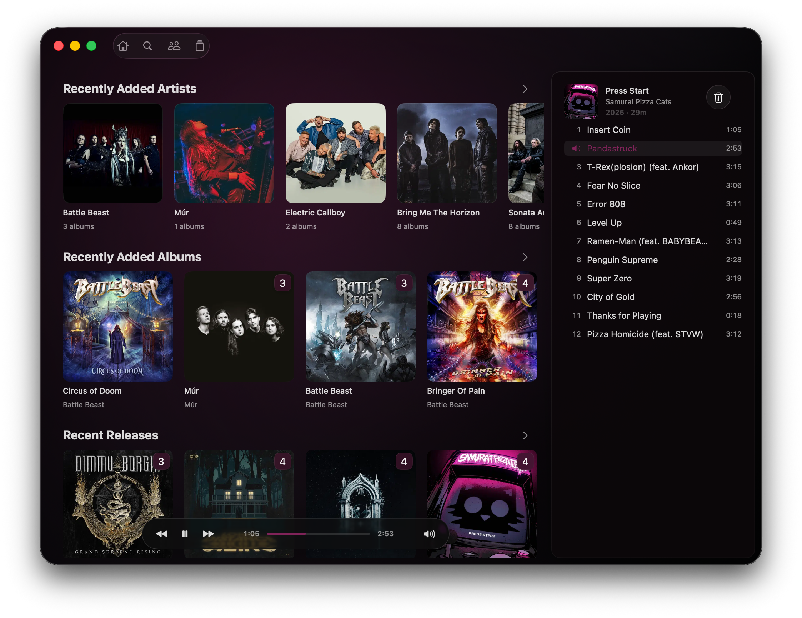
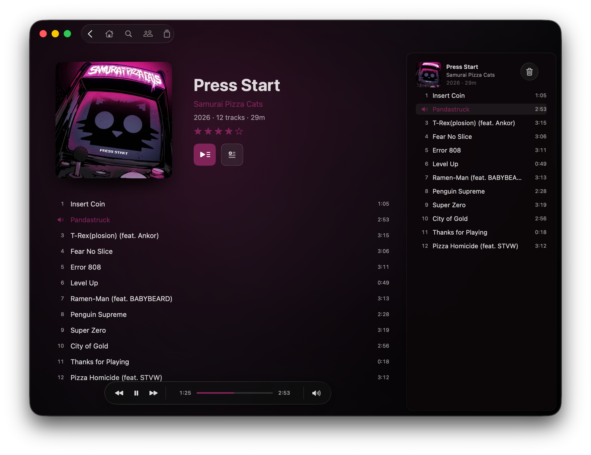
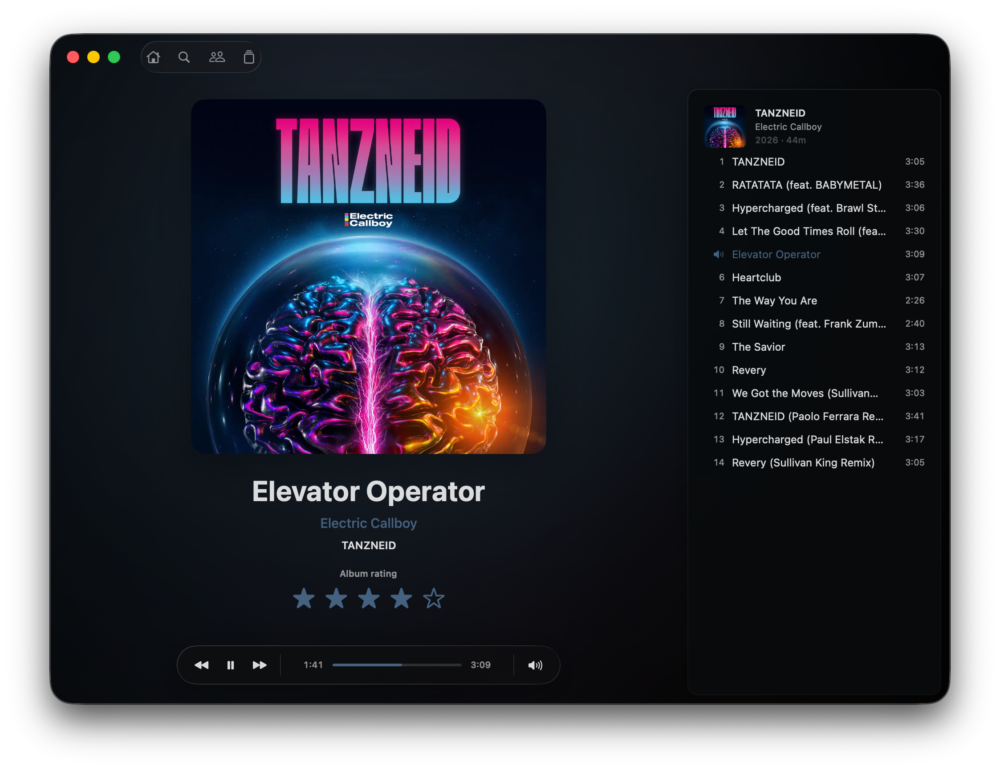
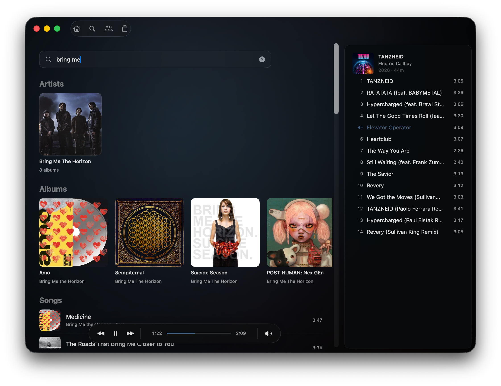

# Coda — Album-First Navidrome Client for macOS

Coda is a focused native macOS client for Navidrome and compatible OpenSubsonic servers. It keeps
artwork, albums, and the listening queue at the center of the experience.

Coda is an independent community project and is not affiliated with or endorsed by Navidrome.

<p align="center">
  
  
</p>

<p align="center">
  
  
</p>

## Highlights

- Artwork-led native macOS design with album-derived colors and Liquid Glass controls.
- Album-first browsing with chronological discographies, multidisc releases, ratings, and search.
- Server-supplied track and album credits with separate artist links. Compilations show
  the track title with a smaller, muted artist credit beneath it in album, grouped playlist, and
  queue rows when Navidrome marks the album as a compilation; other albums keep title-only rows.
  Song search and Now Playing use track credits, while album headers keep album credits.
  Artist search hides artists with zero albums; matching albums and songs remain searchable.
  The Various Artists page presents a compilation collection with a stack icon and a Compilations
  heading. Queue context menus use “Show Artist” for the clicked track or album's first artist.
- A visible, editable queue with drag-and-drop insertion, reordering, removal, and queue handoff.
  Queue and playlist group adjacent tracks by album ID, including consecutive repeated additions;
  grouping preserves track order. Tracks without an album ID remain separate.
  In narrow windows, hover over, click, or drag music to the right edge to reveal the queue over the content;
  it closes shortly after the pointer leaves, or with Escape.
- Original-format playback with gapless transitions, seeking, scrobbling, and saved queue restoration.
- Continue Listening records progress for album sequences and explicit Resume actions. Isolated
  playlist tracks leave album bookmarks unchanged, including existing progress for their albums.
- Optional ReplayGain under Playback → ReplayGain. It automatically uses album gain for
  consecutive songs from the same album and track gain for isolated songs. It defaults to Off
  and remembers your choice; tracks without usable gain metadata play 9 dB quieter when enabled.
- Native media keys, macOS Now Playing integration, and a dedicated immersive Now Playing view.

## Requirements

- macOS 26 or newer on an Apple silicon Mac.
- A Navidrome server or compatible OpenSubsonic implementation.
- Network access to that server; HTTPS is recommended outside a trusted network.

## Install

Download the macOS arm64 ZIP from the latest GitHub release, extract `Coda.app`, and move it to
`/Applications`.

The app is not currently notarized. After reviewing the source, you can remove macOS quarantine
from a downloaded build with:

```sh
xattr -dr com.apple.quarantine /Applications/Coda.app
```

## Build from source

Install Xcode Command Line Tools 26 or newer, Swift 6.2 or newer, and the build dependencies:

```sh
brew install meson ninja pkg-config libunibreak graphite2 freetype fribidi harfbuzz libpng
```

Then build and open the release app:

```sh
./scripts/build-app.sh release
open .build/Coda.app
```

Run the automated tests with:

```sh
swift test
```

Debug builds (the default for `scripts/build-app.sh`) store the server URL, username and password
as plaintext JSON at `~/Library/Application Support/Coda/DevelopmentLogin.json`, with file mode
`0600` and a newly created Coda directory mode `0700`. If that file is absent, a debug launch
reads an existing Keychain login and automatically copies it to this file. Release builds use
Keychain only and do not read or remove the development file. Debug sign-out removes both the
file and the Keychain login; release sign-out removes only the Keychain login. To remove the
plaintext copy without signing out, delete that file and use a release build: launching debug
again can recreate it from Keychain. Keep the development file out of shared reports/backups.

Run the offline ReplayGain audio-output check after building libmpv:

```sh
python3 scripts/check-replaygain-output.py
```

It compiles the production C bridge into a test harness, renders synthetic tones through the
bundled libmpv to WAV files under `.build/replaygain-output-check/`, and checks PCM scaling,
per-file transitions, updated same-URL next gain and disabling gain. It uses no server,
credentials or audio device. Policy and occurrence-state checks remain in `swift test`.

Run the offline gapless audio-output check after building libmpv:

```sh
python3 scripts/check-gapless-output.py
```

It encodes synthetic tracks with odd sample counts as FLAC, Opus, MP3, AAC/M4A (FFmpeg and,
when `afconvert` is present, Apple's encoder) and Ogg Vorbis, then renders queues through the
production C bridge and bundled libmpv. Each case serves the files locally, over HTTP with
ranges, and over HTTP without a length, and requires exactly the encoded number of samples with
no shifted or missing audio at any transition. It needs the `ffmpeg` command-line tool; formats
whose encoder Homebrew's FFmpeg lacks (for example `libvorbis`) are skipped. Bundled FFmpeg
carries the small gapless fixes in `scripts/patches/ffmpeg/`.

The platform-independent ReplayGain behaviour is specified in
[docs/replaygain.md](docs/replaygain.md).

Shared queue and playlist presentation rules and ownership are documented in
[docs/track-list-presentation.md](docs/track-list-presentation.md).

### Selecting artist-credit test albums

With Python 3.11 or newer and `naviclient` installed in the active environment, use the
read-only metadata selector:

```sh
python3 scripts/find-artist-test-cases.py --album "Album title" --discover 2
python3 -m unittest discover -s scripts -p 'test_artist_test_cases.py'
```

Repeat `--album` for each title substring. All matching editions are retained. The script uses
`naviclient.Client.from_config()` to load the existing private `[navidrome]` configuration;
no password prompt is needed. Use `--config /path/to/private/config.toml` or `NAVICLIENT_CONFIG`
to override naviclient's shared configuration defaults. Authentication, TLS, redirects, proxies
and transport limits follow naviclient's behavior. HTTP is supported for trusted LANs; use HTTPS
outside them. Run with your configured venv's Python interpreter when it is not activated.
Use `--artist "Artist name"` to select albums by album-artist credit or individual artist name
instead of title; this can be repeated or combined with `--album`.

It pages through album summaries and fetches tracks only for selected albums. `--discover N`
adds up to N candidates in each album-level category: compilations, multiple album artists,
and explicitly non-compilation single-artist albums. It does not scan every album's tracks for
guests. The default scan limit is 20,000 albums (`--max-albums` overrides it).

The private JSON report under `.build/artist-test-cases/` preserves display credits, artist IDs
and arrays, and compilation flags (including absence). It flags varying track credits and
possible shared recordings across selected albums. Matching titles alone are candidates, not
proof of identical recordings. Missing queries and ambiguous editions remain visible in
`requestedMatches` and `requestedArtistMatches`. A separate candidate comparison removes parenthesized
`feat.` / `ft.` credits from titles; it does not establish recording identity. These are
server-interpreted fields, not a dump of the files' original tags.
Reports contain personal library metadata: keep them untracked. Credentials, server URLs,
file paths and artwork are excluded. No playback, tag edits, ratings or server scans are triggered.

## Privacy

Coda contains no analytics, advertising, or tracking SDK. It communicates only with the server
configured by the user.

Artwork responses are cached only in memory and are discarded when Coda exits. The artwork cache
does not intentionally write OpenSubsonic authentication values or request URLs to disk.

## License

Copyright 2026 iamtoolino.

Coda's source code is licensed under the [Apache License, Version 2.0](LICENSE). Bundled libraries
retain their respective licenses; their notices are included in the built app.
